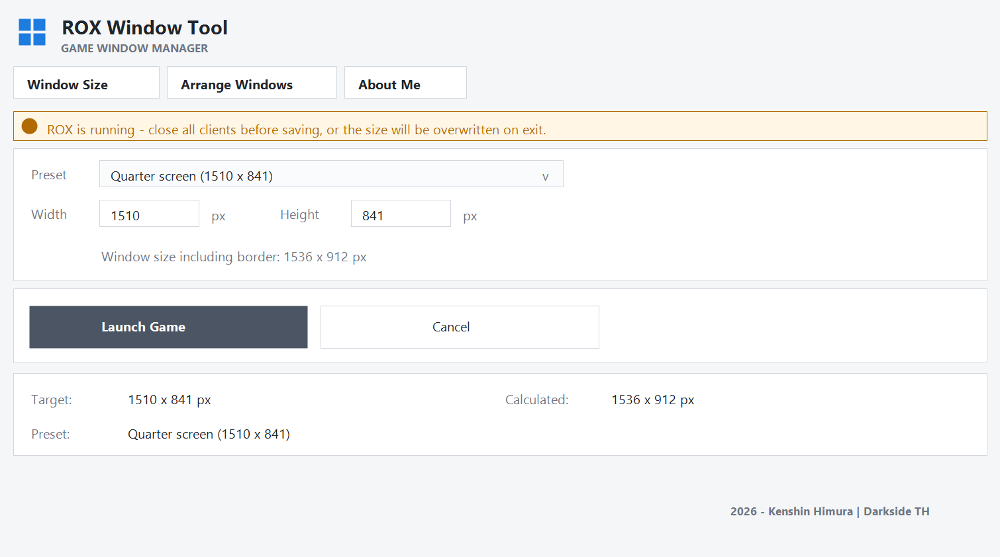

# ROX Window Tool

A small Windows utility for **Ragnarok X Next Generation (SEA)** that sets the game window size and arranges multiple game clients into a clean grid.

Built with C# and .NET Framework 4.8 (WinForms). No installer, no background service, no network access.



## Download

Get the latest build from the [Releases page](https://github.com/balxor/rox-window/releases/latest):

**ROX-Window-Tool-v1.0.0.exe** (39 KB) - extract and run, no installer.

## Features

- **Exact window size** — choose a preset or type width/height in pixels. The value is the game client area; the border and title bar are calculated with `AdjustWindowRectEx`.
- **Layout presets** for 1 to 6 clients, based on your monitor work area.
- **Arrange Windows** — tile 1 to 9 open clients with no gaps; the last row is centred.
- **Two orientations for 2 clients** — side by side, or stacked (each window the size of a 4-window cell, centred).
- **Launch Game** — writes the size to the game's own registry entry and starts `rox.exe` directly.
- **About Me** — build information, the executable's own SHA-256 (computed at runtime) and a link to VirusTotal.

## Requirements

- Windows 10 or 11 (64-bit)
- .NET Framework 4.7 or newer (already included in Windows)
- Ragnarok X installed and started at least once, so its settings exist in the registry

## Usage

1. Close all ROX clients.
2. Run `ROX Window Tool.exe`.
3. **Window Size** tab: choose a preset or type the size, then click **Launch Game**.
4. **Arrange Windows** tab: choose how many windows, pick an orientation if you selected 2, then click **Arrange Now**.

The window setting is stored at:

```
HKEY_CURRENT_USER\Software\gravity\ro3
  Screenmanager Resolution Width_h182942802
  Screenmanager Resolution Height_h2627697771
  Screenmanager Fullscreen mode_h3630240806   (3 = windowed)
  Screenmanager Resolution Use Native_h1405027254
```

## Notes

- The client stores its own window size when it exits. Close the game before changing the size, otherwise your new value is overwritten.
- The client re-applies its internal resolution when the login scene loads. If a client still changes size on its own, set the display once from the in-game Settings menu.
- Fullscreen and borderless modes were removed on purpose: changing the window style makes an exact client size impossible to guarantee.
- The executable is **not code-signed**. Windows SmartScreen may show "Windows protected your PC" — choose **More info → Run anyway**.

## Build

The project has no external dependencies beyond the .NET Framework libraries.

```bat
C:\Windows\Microsoft.NET\Framework64\v4.0.30319\csc.exe ^
  /nologo /target:winexe /out:"ROX Window Tool.exe" ^
  /reference:System.dll /reference:System.Drawing.dll /reference:System.Windows.Forms.dll ^
  RoxCompact.cs BuildInfo.cs
```

## Antivirus false positives

Small unsigned .NET executables are sometimes flagged by heuristic engines. The tool only writes four values to the game's own registry key and starts `rox.exe`. Source code is available in this repository for review.

## License

MIT — see [LICENSE](LICENSE).

## Author

Kenshin Himura — Darkside TH, Srikandi server.
